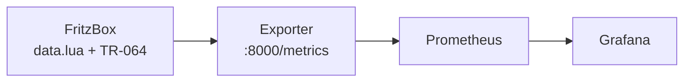
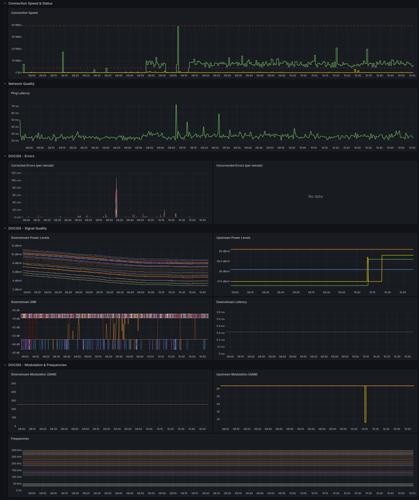

# FritzBox Cable Monitoring

[](https://github.com/fabianwimberger/fritzbox-monitoring/actions)
[](https://codecov.io/gh/fabianwimberger/fritzbox-monitoring)
[](https://github.com/fabianwimberger/fritzbox-monitoring/pkgs/container/fritzbox-monitoring)
[](https://opensource.org/licenses/MIT)

> **⚠️ Disclaimer**: This is an independent, community-created project. It is **not affiliated with, endorsed by, or sponsored by AVM GmbH**. "AVM", "FRITZ!Box", and associated logos are trademarks of AVM GmbH. Use of these names is solely for identification and compatibility purposes. Use at your own risk.

A Prometheus exporter for AVM FritzBox cable modems. Collects DOCSIS signal quality metrics, connection speeds, and ping latency.

## Background

AVM's web UI shows live DOCSIS values but keeps no history, which makes tracking down intermittent cable issues painful. The FritzBox exposes the same data via its internal endpoints. This exporter scrapes them, serves Prometheus metrics, and ships a Grafana dashboard so signal quality, speeds, and error counters stay visible over time.

## Features

- **DOCSIS signal metrics** — upstream/downstream power levels, SNR, modulation (QAM), frequencies, latency
- **Error tracking** — corrected and uncorrected downstream error counters, persisted across restarts
- **Connection speeds** — real-time upload/download speeds and max link rates via TR-064
- **Ping monitoring** — RTT measurements to a configurable target
- **Grafana dashboard** — ready-to-import dashboard included
- **Docker** — lightweight Alpine-based image, pre-built for AMD64 and ARM64

## Quick Start

```bash
git clone https://github.com/fabianwimberger/fritzbox-monitoring.git
cd fritzbox-monitoring
cp .env.example .env   # set FRITZBOX_USER and FRITZBOX_PASSWORD
docker compose up -d
```

This pulls `ghcr.io/fabianwimberger/fritzbox-monitoring:latest` (AMD64 and ARM64) and serves metrics on `http://localhost:8000/metrics`.

### Building from source

```bash
cp docker-compose.override.yml.example docker-compose.override.yml
make build
make up
```

### Without Docker

```bash
uv sync
.venv/bin/python exporter.py
```

## How It Works



Each Prometheus scrape triggers a fresh read: DOCSIS channel data from the FritzBox web interface (`data.lua`), link rates via TR-064, and a ping to `PING_TARGET`. Error counters are written to `STATE_FILE` so totals survive a restart.

## Configuration

All configuration is done via environment variables:

| Variable | Default | Description |
|----------|---------|-------------|
| `FRITZBOX_IP` | `192.168.178.1` | IP address of your FritzBox |
| `FRITZBOX_USER` | *(required)* | FritzBox username |
| `FRITZBOX_PASSWORD` | *(required)* | FritzBox password |
| `PING_TARGET` | `1.1.1.1` | Host to ping for latency measurement |
| `PORT` | `8000` | Exporter HTTP port |
| `STATE_FILE` | `/app/data/fritzbox_exporter_state.json` | Path to error-counter state file |
| `LAN_HOST_INTERVAL_SECONDS` | `180` | Minimum time between LAN host refreshes |

## Metrics

Per-channel DOCSIS upstream and downstream values (power level, frequency, modulation, SNR, error counters), connection speeds, ping RTT, and active LAN hosts, all prefixed `fritzbox_`. The full list with labels is in [docs/metrics.md](docs/metrics.md).

## Grafana Dashboard

<p align="center">
  
  <br><em>FritzBox Cable Monitoring dashboard in Grafana</em>
</p>

Import `grafana-dashboard.json` into your Grafana instance.

## Prometheus Configuration

Add this job to your `prometheus.yml`:

```yaml
scrape_configs:
  - job_name: 'fritzbox'
    static_configs:
      - targets: ['localhost:8000']
    scrape_interval: 30s
```

## Requirements

- AVM FritzBox with DOCSIS cable connection
- FritzBox user account (not necessarily admin, but needs access to cable info)
- Docker & Docker Compose (recommended) or Python 3.13+
- Prometheus (to scrape the exporter)
- Grafana (optional, for the included dashboard)

## Troubleshooting

- **Authentication failures** — the user must exist under *System > FRITZ!Box Users* and be allowed to view cable information.
- **No DOCSIS metrics** — only cable models expose them; DSL and fiber models do not.
- **Ping fails outside Docker** — `ping` must be available on the host; the image ships `iputils`.

## License

[MIT](LICENSE)
